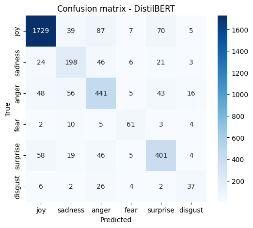

# Emotion Classification with Deep Learning

An emotion classification project using the **GoEmotions** dataset. The project maps the original GoEmotions labels into six emotion categories and compares four deep learning models: LSTM, GRU, BiLSTM with Attention, and DistilBERT.

## Project Overview

The goal is to predict the dominant emotion expressed in an English text.

The six target emotions are:

- Joy
- Sadness
- Anger
- Fear
- Surprise
- Disgust

The original GoEmotions dataset contains multiple emotion labels. For this project, labels are grouped into six categories using an Ekman-inspired mapping. Neutral examples and examples containing more than one mapped emotion are excluded, so each retained sentence has one target emotion.

## Dataset

- **Dataset:** GoEmotions (simplified configuration)
- **Source:** Hugging Face Datasets
- **Loading:** `load_dataset("go_emotions", "simplified")`
- The original train, validation, and test splits are used.
- The dataset is filtered and mapped to the six target emotions described above.

## Workflow

1. Load the GoEmotions dataset.
2. Explore label distribution and sentence lengths.
3. Map the original labels into six emotion categories.
4. Remove neutral and ambiguous/multi-emotion examples.
5. Clean and tokenize text for the recurrent neural network models.
6. Use pre-trained GloVe 100-dimensional word embeddings.
7. Train and evaluate LSTM, GRU, and BiLSTM + Attention.
8. Fine-tune DistilBERT using the Hugging Face Trainer.
9. Compare the models using Accuracy and Macro F1-score.
10. Run a Gradio interface for text prediction.

## Models and Results

| Model | Accuracy | Macro F1 |
|---|---:|---:|
| LSTM | 0.6589 | 0.5510 |
| GRU | 0.6731 | 0.5878 |
| BiLSTM + Attention | 0.6612 | 0.5738 |
| **DistilBERT** | **0.8101** | **0.7009** |

### Key Findings

- DistilBERT achieved the best overall performance, with **81.01% accuracy** and **70.09% Macro F1-score**.
- GRU achieved the best results among the three recurrent neural network models.
- BiLSTM with Attention achieved a higher Macro F1-score than the standard LSTM.
- DistilBERT performed better than the evaluated RNN architectures on this dataset.

## DistilBERT Confusion Matrix

The confusion matrix below shows the number of correct and incorrect predictions for each emotion class.



The model performs best on **Joy**. **Disgust** is the most challenging class based on recall, and some confusion occurs between Anger and Surprise.

## Installation

It is recommended to use a virtual environment.

```bash
python -m venv .venv
```

Activate it:

**Windows**
```bash
.venv\Scripts\activate
```

**macOS / Linux**
```bash
source .venv/bin/activate
```

Install the dependencies:

```bash
pip install -r requirements.txt
```

## Run the Notebook

Open `emotion_classification.ipynb` in Jupyter Notebook, JupyterLab, or Google Colab and run the cells in order.

The notebook downloads the GoEmotions dataset and GloVe embeddings when those resources are first requested. Fine-tuning DistilBERT is computationally intensive; a GPU is recommended.

## Run the Gradio App

After training DistilBERT and saving the model and tokenizer to the `emotion_distilbert` directory, make sure `app.py` is in the same project directory and run:

```bash
python app.py
```

The app accepts an English text and displays the predicted dominant emotion along with confidence scores for all six classes.

> The `emotion_distilbert/` model directory is created by the notebook when `trainer.save_model("emotion_distilbert")` and `bert_tokenizer.save_pretrained("emotion_distilbert")` are executed. It is not recreated by running `app.py` alone.

## Project Structure

```text
Emotion-Classification/
├── emotion_classification.ipynb
├── app.py
├── requirements.txt
├── README.md
├── confusion_matrix_distilbert.png
└── emotion_distilbert/        # saved after training
```

## Technologies

- Python
- TensorFlow / Keras
- Hugging Face Transformers
- Hugging Face Datasets
- GloVe word embeddings (via Gensim)
- Scikit-learn
- Pandas and NumPy
- Matplotlib and Seaborn
- Gradio

## Notes

- The reported scores are from the notebook's test-set evaluation.
- The RNN models use cleaned text, tokenization, padding, and frozen GloVe embeddings.
- DistilBERT uses the original text with its own tokenizer.
- Results may vary slightly depending on the environment, library versions, and training setup.
